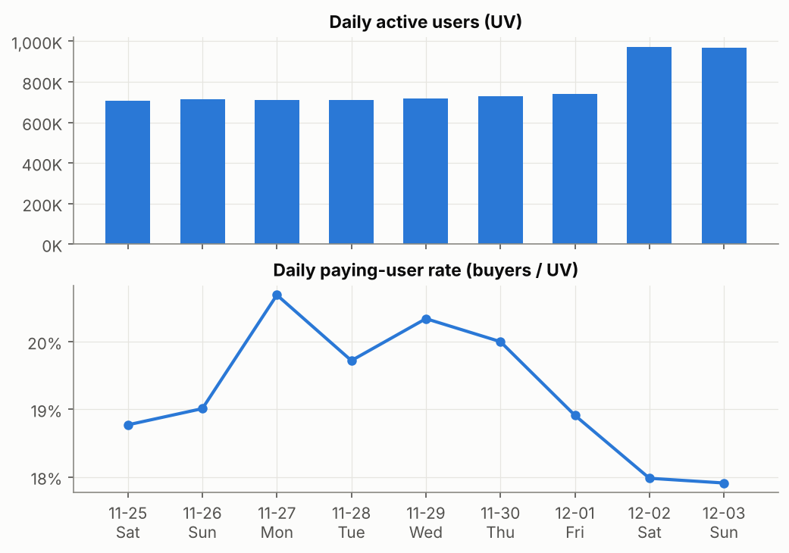
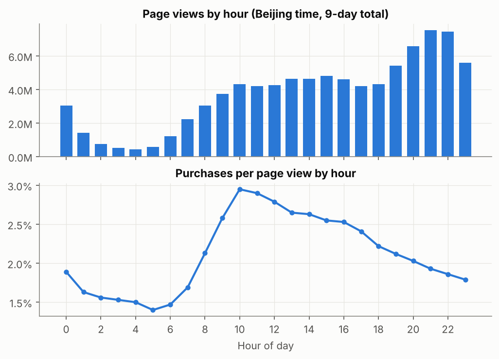
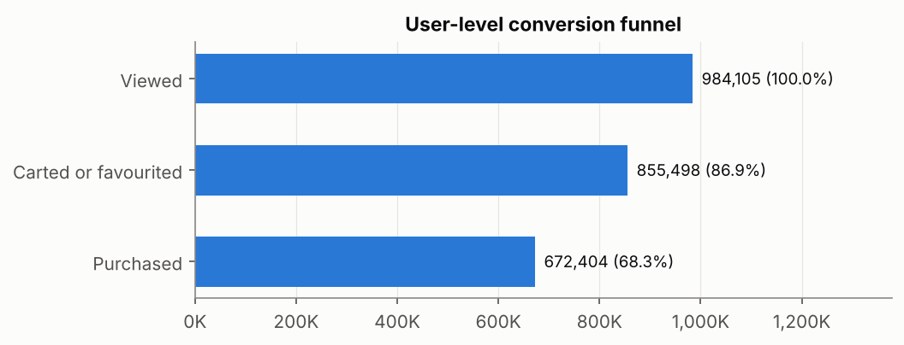
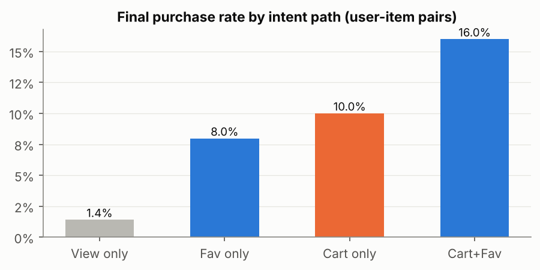
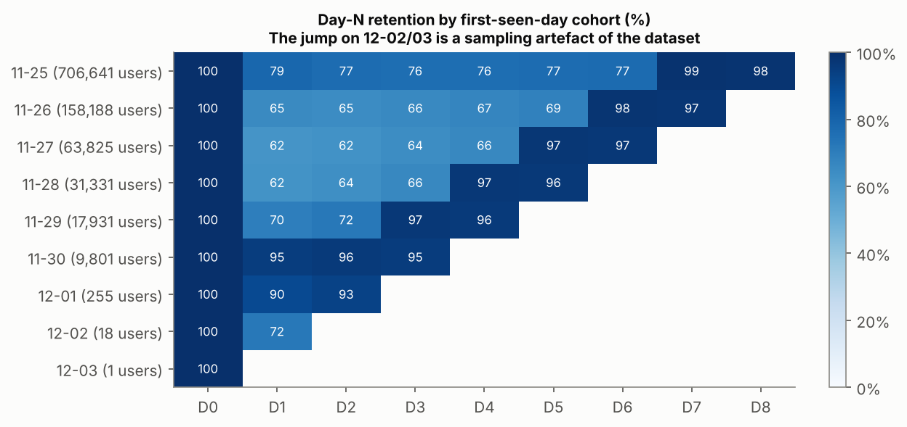
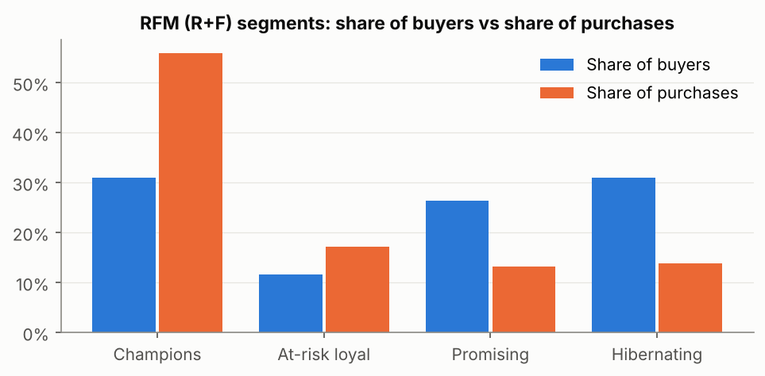
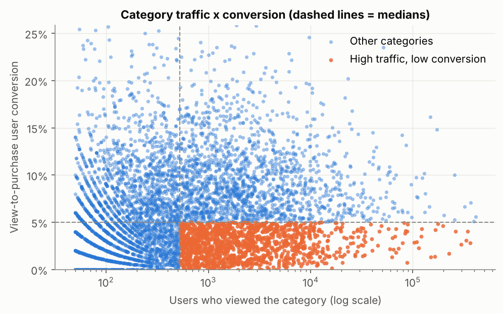

# Taobao User Behaviour Analysis

> Data: Tianchi UserBehavior, full dataset
> Raw 100,150,807 rows -> 100,095,182 rows after cleaning (55,625 duplicate, out-of-window or invalid rows removed)

## 0. Executive summary

| Area | Key numbers | Interpretation |
|---|---|---|
| Scale | UV 987,991; PV 89,660,671; 90.8 PV per user | Context for everything below |
| Paying users | 68.1% of users bought within 9 days | 31.9% of users made no purchase |
| Funnel | View -> cart/fav 86.9%; intent -> purchase 70.2% | Larger drop-off: intent -> purchase |
| Intent path | Purchase rate: cart 10.0%, fav 8.0%, view only 1.4% | Carting lifts purchase rate 7.1x vs viewing only, yet 76% of purchases skip cart/fav entirely; only 18% go through the cart |
| Timing | Views peak at 21:00; purchases per view peak at 10:00 | Best hours for reach and for conversion differ |
| Retention | 11-25 cohort: D1 78.9%, D2-D6 average 76.5% | The jump on 12-02/03 is a sampling artefact (section 3) |
| Repurchase | 55.1% of buyers bought on 2+ different days | |
| Segments | Champions are 31.0% of buyers and make 55.9% of purchases | Purchase share is 1.8x their headcount share |
| Items | Top 1% of items take 46.0% of purchases; only 638,962 of 4,161,138 viewed items sold | Strong long tail |

## 1. Traffic
- Peak daily UV was 2017-12-02 (Saturday) at 970,401; weekday average 721,802. On the last day UV reaches 98% of all users. This is mainly caused by **how the dataset was sampled** (almost every sampled user is active on 12-02/03), on top of the weekend and the run-up to Double 12. It must not be read as real traffic growth.
- Paying-user rate averages 19.9% on weekdays vs 18.9% on 2 unaffected weekend day(s) (12-02/03 excluded as a sampling artefact). With so few weekend days this is a hint, not a finding: weekend visitors may browse more and buy less.
- Strict bounce rate (a single page view only) 0.01%; "browse only" users (never cart, fav or buy) 6.0%.

## 2. Conversion

**Recommendation 1: push add-to-cart.** There are 67,277,652 "view only" user-item pairs. If a better add-to-cart button or a cart coupon moved 1% of them into the cart,
the purchase-rate gap (10.0% - 1.4%) implies about **57,859 extra purchases (+4.4%)**.
This is an upper-bound estimate from observational data; the real effect has to be confirmed with an A/B test.

## 3. Retention and repurchase

- **How to read this chart (raise it in interviews):** every cohort jumps above 95% in the 12-02/03 columns. This is fake retention created by how the dataset was sampled (almost all sampled users are active on the last two days), not users actually returning. Only the part before 12-02 is meaningful: the 11-25 cohort keeps 78.9% on D1 and about 77% on D2-D6.
- Second limitation: the window is only 9 days, so "first seen day" is not a real sign-up date and early cohorts contain many existing users.

## 4. User segments (RFM with R+F only; the data has no order value)

| Segment | Buyers | Share of buyers | Share of purchases | Avg R (days) | Avg F (purchases) | Action |
|---|---|---|---|---|---|---|
| Champions | 208,314 | 31.0% | 55.9% | 1.68 | 5.41 | Member perks, early access to new items; prevent churn |
| At-risk loyal | 78,304 | 11.7% | 17.2% | 5.31 | 4.42 | Bought often but not recently -> win-back coupons |
| Promising | 177,613 | 26.4% | 13.1% | 1.86 | 1.49 | Bought recently but rarely -> cross-sell to build repeat purchases |
| Hibernating | 208,173 | 31.0% | 13.8% | 6.23 | 1.34 | Low-cost reach only; cap marketing spend |

Thresholds: mean R = 3.56 days, mean F = 3.0 purchases.

## 5. Categories

**Recommendation 2: fix high-traffic, low-conversion categories first.** 1329 categories have more viewers than the median (528) but a conversion rate below the median (5.0%).
Lifting them to the median conversion would add about **191,061 user-category purchases** (details in `tables/category_opportunity.csv`).
Things to check: price band, product-page quality, reviews, stock.

## 6. Limitations and next steps
1. No order value or item attributes -> RFM has no M; GMV and average order value cannot be computed
2. 9-day window right before Double 12 -> strong seasonality; do not generalise the findings
3. The recommendations rest on correlations; causality needs A/B testing
4. Next: user-item features + logistic regression / LightGBM to predict purchase after add-to-cart, for targeted reminders
